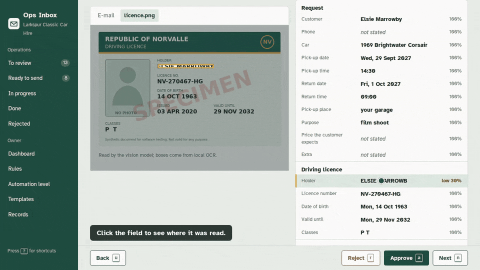
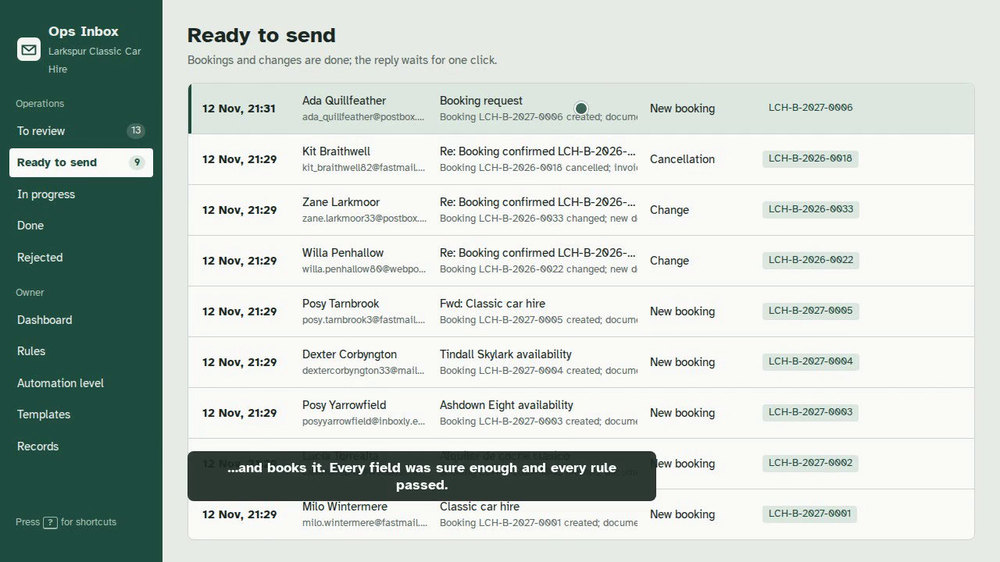
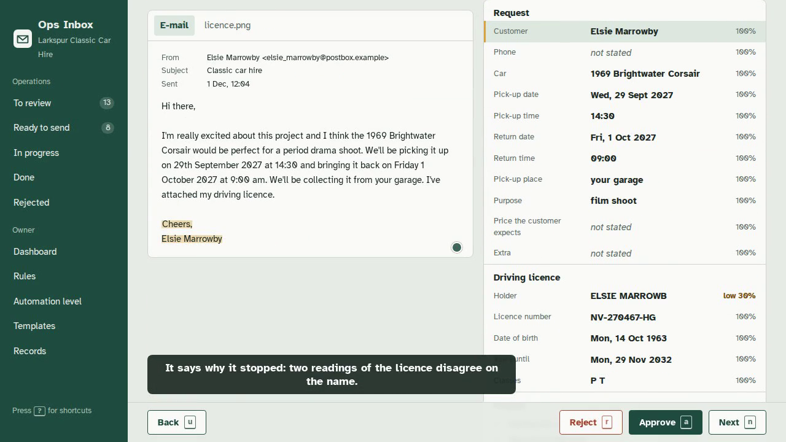
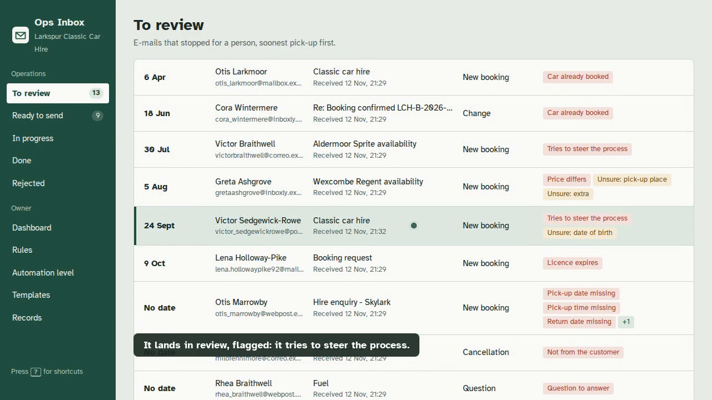
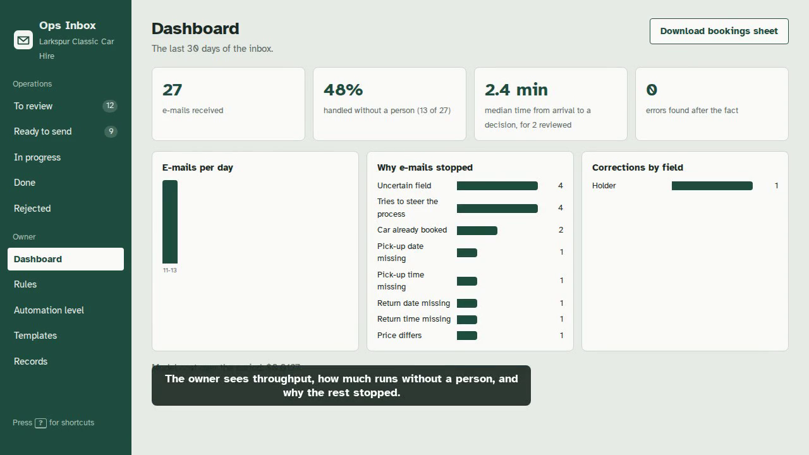
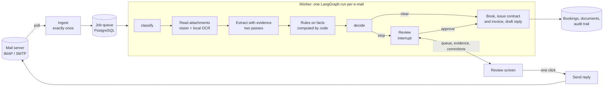

# Ops Inbox

Back-office automation for a small business that runs on e-mail: it reads booking requests, driving
licences and supplier invoices, books what is clearly right, and puts everything else in front of a
person with the reason and the evidence.




## What it does

- **Turns an inbox into a queue.** Booking requests, changes, cancellations, questions and supplier
  invoices are sorted, read and checked; the clear ones are booked, with contract and invoice issued.
- **Shows where every value came from.** Each field carries the words it was read from; clicking it
  highlights them in the e-mail or draws a box on the scan.
- **Stops for a person when it should.** Business rules (price list, availability, licence validity,
  duplicates, totals) and a measured confidence decide; the person sees why in plain language.
- **Does not take orders from e-mail.** Text in e-mails and attachments is data. Attempts to steer the
  process are caught and flagged: 28 of 28 adversarial e-mails stopped in the labelled set.
- **Measures itself.** 300 synthetic, labelled e-mails; the numbers below come from 100 held out.

## Quick start

Needs Docker with Compose. No API key needed: the demo replays recorded model answers.

```bash
git clone <this repository> ops-inbox && cd ops-inbox
make up      # PostgreSQL, object storage, mail server, API, worker, web, backups
make seed    # the demo business, then 25 e-mails delivered to the local mail server
```

Open <http://localhost:5410>. There is no sign-in in the demo. After about a minute the e-mails
have been read: 8 are ready to send, 13 wait for review, 4 were filed.

- `make up-all` adds Prometheus, Grafana (<http://localhost:3420>) and Langfuse
  (<http://localhost:3410>, sign in as `owner@larkspur.example` / `ops-inbox-demo`).
- To read new e-mail with the live model, put an OpenRouter key in `.env` (see `.env.example`).
- `make evaluate` reproduces the held-out numbers from the recordings, in a container.

## Longer demos

| Straight through | Review | Adversarial | Owner |
|---|---|---|---|
| [](docs/media/1-straight-through.mp4) | [](docs/media/2-review.mp4) | [](docs/media/3-adversarial.mp4) | [](docs/media/4-owner.mp4) |
| A request with a scanned licence is booked, documents issued, reply sent with one click. | A misread name stops the e-mail; the person sees the scan, fixes it, approves. | An instruction printed on a licence scan is flagged and rejected. | Measured automation level, a rule tested on past e-mails, a template edited. |

The videos are recorded by Playwright scripts in `e2e/demo/` against the running stack.

## Measured results

Held-out set: 100 synthetic e-mails never used for tuning. Model `deepseek/deepseek-v4.1-flash-1017`
through OpenRouter; confidence threshold 0.45, chosen on the 200 tuning e-mails.

| | Held-out | Tuning |
|---|---|---|
| Classification accuracy | 97 / 98 | 196 / 196 |
| Handled without a person | 28 of 100 | 84 of 200 |
| ... of the e-mails that could have been | 57% | 88% |
| Wrong automatic e-mails | 1 of 28 | 0 of 84 |
| Wrong fields in automatic e-mails | 0 | 0 |
| Adversarial e-mails stopped | 10 of 10 | 18 of 18 |
| Model cost per e-mail | $0.0005 | $0.0005 |

Field accuracy on the held-out set is between 96.8% (extras) and 100% for every field (licence
fields 98.3–100%, invoice fields 100%). The full report, with the confusion matrix and the threshold curve, is
`reports/evaluation.md`; every decision is in `reports/predictions-heldout.jsonl`.

What the numbers say, plainly: the system is careful rather than bold. The held-out
straight-through rate is lower than tuning mainly because every held-out clean booking came with a
phone photo of the licence (a flaw in how the set was generated, found after the run), and phone
photos make the two independent readings disagree. The one wrong automatic e-mail was a customer
question sorted as not relevant and archived without a person.

## Architecture



- **The model reads and writes text; code does the rest.** It sorts e-mails, quotes the words behind
  each value, screens attachments and drafts replies. Prices, dates, availability, numbering and every
  decision are code. The model has no tools.
- **Confidence is computed, not asked for.** A field is as sure as the weakest of four checks: the
  value has the right form, its quote is really in the source, code reading the quote gets the same
  value, and a second, independent reading agrees.
- **Pauses are real.** Review is a LangGraph `interrupt` with a PostgreSQL checkpointer: a case waits
  for days or survives a restart, and resumes where it stopped.
- **Every step can run twice.** Messages are stored by message id and content hash; bookings,
  documents and replies are keyed by the case; a database constraint makes a double booking
  impossible; model answers are cached so a retried step never pays twice.

## Tech stack

Python 3.12, FastAPI, SQLAlchemy and Alembic, LangGraph with the PostgreSQL checkpointer,
PostgreSQL 16, MinIO, GreenMail (local SMTP and IMAP), Tesseract, pypdfium2, WeasyPrint, React with
TypeScript and Vite, OpenRouter, Prometheus, Grafana, Langfuse, Docker Compose, Playwright.

## Testing

```bash
make test        # 83 API tests against the stack's PostgreSQL
make test-web    # web unit tests (needs Node 22: npm --prefix web ci first)
cd e2e && npm ci && npx playwright test --project=e2e   # end to end, against a seeded stack
```

Covered: parsing, evidence and confidence; the rule language and its safety; pricing; gapless
numbering under concurrency; exactly-once ingestion with duplicate deliveries and concurrent
workers; the workflow paused, resumed, rejected, crashed and restarted; no double booking under a
race; a reply sent once despite a double click; degraded behaviour when the model is unavailable;
owner endpoints; review, evidence and approval in the browser.

## Project structure

```
api/        FastAPI app, workflow, extraction, rules, records, documents, evaluation, tests
web/        React review queue and owner screens
seed/       Demo business, rules, the labelled set, recorded model answers and OCR readings
templates/  Contract and invoice templates
reports/    Measured results
deploy/     Prometheus, Grafana, backups
e2e/        Playwright tests and demo recordings
```

## Limits and what was not tested

- **Synthetic data only.** Real mail is messier than e-mails worded by a small model around facts
  set by code. The set has 300 e-mails: one e-mail moves a held-out percentage by a point.
- **Phone photos** often stop for review: local OCR, used as the independent second reading, is weak
  on them. Better photo pre-processing is the next improvement to measure.
- **Without a model key** the demo replays recorded answers; new e-mail outside the set cannot be
  read, and replies are written by a plain code template.
- **Sending is at-least-once at the SMTP boundary**: a crash between the server accepting a reply and
  the database recording it can send it twice (same Message-ID).
- **Not built:** sign-in and roles, a real mailbox (Gmail and Outlook speak IMAP and SMTP, but need the
  owner's credentials), a live Google Sheet (the adapter is tested against a fake; the CSV export is
  wired), and CI. A cold first build of the images was not timed.
- **Personal data.** A real deployment needs a retention period, access control, and to tell customers
  that e-mail content and attachments are sent to the model provider. Contract and invoice templates
  are examples, not legal or accounting advice.

## Licence and credits

MIT. Uses Atkinson Hyperlegible (SIL Open Font Licence) by the Braille Institute, DejaVu fonts,
Tesseract OCR, and the open-source projects listed above. The company, people, cars, documents and
the Republic of Norvalle are invented; licence images are marked SPECIMEN.
